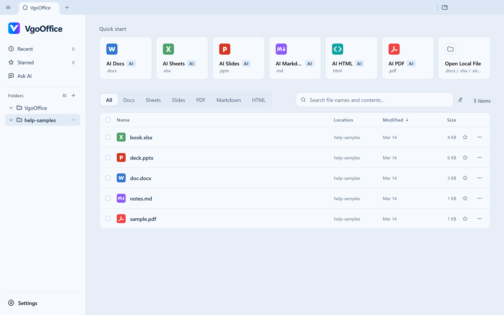

<!-- Modified for VgoOffice (https://github.com/vgo1012/VgoOffice); see MODIFICATIONS.md. -->
<p align="center">
  
</p>

<h1 align="center">VgoOffice</h1>

<p align="center">文档、表格、演示、PDF、Markdown 与 HTML，一套桌面办公工作台。<br>本地编辑，自选 AI，浅蓝界面。</p>

<p align="center">
  <a href="https://github.com/vgo1012/VgoOffice">给 VgoOffice 点 Star</a> ·
  <a href="https://github.com/vgo1012/VgoOffice/releases">安装包与版本发布</a> ·
  <a href="../../README.md">English</a> ·
  <a href="../../LICENSE">Apache-2.0</a>
</p>

VgoOffice 将六种文件编辑器集中在一个带标签页的桌面软件中。打开本地文件，
直接编辑，再保存为原有办公格式。AI 是可选能力：按需连接自己的模型 API、
OpenAI 兼容接口，或已经安装的 Codex CLI。

本项目基于 [genspark-ai/genoffice](https://github.com/genspark-ai/genoffice)
定制，保留原有文件引擎和开源声明，提供 VgoOffice 品牌、浅蓝主题和无需软件
账户登录的桌面使用流程。



## 六种编辑器

| 编辑器          | 文件                    | 主要能力                                                             |
| --------------- | ----------------------- | -------------------------------------------------------------------- |
| **Docs 文档**   | `.docx`                 | 编辑文字、表格和页面布局，审阅 AI 修改，保存 Word 文档。             |
| **Sheets 表格** | `.xlsx`、`.xls`、`.csv` | 编辑数据、公式、多张工作表和图表；需要保留工作簿功能时使用 `.xlsx`。 |
| **Slides 演示** | `.pptx`                 | 编辑幻灯片文字、形状和图片，使用已配置的 AI 制作演示。               |
| **PDF**         | `.pdf`                  | 阅读和编辑 PDF 内容，通过本地引擎及可用的系统 OCR 转换文件。         |
| **Markdown**    | `.md`                   | 编写 Markdown，预览排版结果，导出为支持的文档格式。                  |
| **HTML**        | `.html`                 | 编辑与预览 HTML，将支持的页面结构导出为可编辑的 Word 文档。          |

- **本地文件处理。** 打开、编辑、保存和本地格式转换在电脑上完成。模型调用、
  搜索和媒体能力使用你配置的服务。
- **统一工作台。** 从首页、最近文件或拖放打开文件，通过标签页切换编辑器。
  文件搜索可以在本地索引文件名和正文。
- **自选 AI。** 设置自己的模型服务商和凭据，也可连接本地 OpenAI 兼容端点。
  已安装的 Codex CLI 沿用它自己的配置与认证。
- **可审阅的修改。** 支持的 AI 编辑可以在编辑器中审阅和撤销。文件引擎尽量
  保留未修改内容；复杂文件在对外发送前应使用原始办公软件复核。
- **脚本与集成。** 随软件提供的 `genoffice` CLI 和 MCP 接口可供脚本、编程
  助手调用文档操作。

## VgoOffice 定制内容

- 软件界面和安装程序统一使用 VgoOffice 名称与 V 标志。
- 默认主背景为浅蓝灰色 `#E8EEF7`；在「设置 → 通用」选择浅色、深色或跟随
  系统。文档自身的纸张、单元格和幻灯片颜色由文件控制。
- 移除桌面账户登录、账户设置及账户云项目入口；模型与媒体功能使用独立
  配置的服务。
- 使用 Windows 安装包：资源只在安装时写入程序目录，安装后直接启动，避免
  单文件免安装程序反复解压。
- 修复 Windows 设置中 Office 默认程序中文名称的显示乱码。
- 「设置 → 关于」提供 [VgoOffice 项目 Star 链接](https://github.com/vgo1012/VgoOffice)。

技术命令 `genoffice`、`GENOFFICE_*` 环境变量和 `@genoffice/*` 工作区包名继续
保持兼容。从 Eoffice 升级时保留原 Windows 安装身份和 `%APPDATA%\Eoffice`
配置目录，程序文件名为 `VgoOffice.exe`。

## 安装与启动

在 [VgoOffice Releases](https://github.com/vgo1012/VgoOffice/releases)
查找 **Windows x64 安装包**。只有发布条目附有安装包资产时才能下载安装；
本说明不代表 GitHub 上已经上传了二进制版本。

升级前保存办公文件并关闭旧版。运行安装程序，随后从桌面或开始菜单的
**VgoOffice** 快捷方式启动。普通用户不需要安装 Node.js、Rust 或下载源码。
分发时使用完整安装包，单独复制 `VgoOffice.exe` 会缺少编辑器运行资源。

本定制版已在 Windows x64 上验证安装与运行。仓库保留 macOS 和 Linux 的
源码目标，但尚未验证本定制版在这两个平台上的运行。本地构建在没有签名
凭据时生成未签名程序。不同 Office 版本制作的文件可能存在兼容性差异。

## 配置 AI

1. 打开「设置 → AI 模型」。
2. 选择服务商，填写自己的 API Key 与模型，或配置自定义 OpenAI 兼容
   Base URL，使用连接测试检查配置。
3. 使用已安装的 Codex CLI 时，选择 Codex，确认可执行文件与模型检测。
   CLI 本身的安装与认证由其配置负责。
4. 需要搜索、图片生成或媒体解析时，在「设置 → 生图、媒体与搜索」单独
   配置对应能力。

本地编辑不需要 VgoOffice 软件账户。第三方服务可能需要凭据、网络连接，
并产生使用费用。使用 AI 功能时，相关输入可能发送给所选服务商；详见
[隐私说明](../../PRIVACY.md)。

## CLI 与 MCP

兼容命令继续叫 `genoffice`。「设置 → 集成」提供已安装 CLI 的实际路径和
集成配置入口。

```bash
genoffice --version
genoffice info report.docx --json
genoffice sheet read budget.xlsx --range A1:D20 --json
genoffice convert notes.md --to docx
genoffice open report.docx
genoffice mcp
```

这些示例要求已将 CLI 添加到 PATH，或改用完整路径调用。文档操作、自动化和
MCP 的完整说明见 [CLI 参考](../../packages/cli/README.md)。

## 从源码运行

开发环境需要 **Node.js 22.12+**、**npm 10+**，以及 PATH 中可用的 Rust
工具链与 `cargo`，用于构建表格原生引擎。Windows 原生构建还需要与所选 Rust
工具链匹配的 C/C++ 链接器。

```bash
git clone git@github.com:vgo1012/VgoOffice.git
cd VgoOffice
npm install
npm run fixtures
npm run dev
```

HTTPS 克隆地址为 `https://github.com/vgo1012/VgoOffice.git`。单独运行文档
编辑器使用 `npm run dev:docs`；构建全部编辑器和主程序使用 `npm run build:all`。

### 构建 Windows 安装包

打包配置要求表格原生程序位于
`apps/sheets/native/xlsx-engine/target/x86_64-pc-windows-gnu/release/xlsx-sidecar.exe`。
可以使用匹配的 GNU 链接器构建该 Rust 目标，也可将已构建的 Windows 原生
程序放到此路径。默认 Windows Rust 构建输出在 `target/release` 时，可在仓库
根目录的 PowerShell 中执行：

```powershell
npm run native:build -w @genoffice/sheets
New-Item -ItemType Directory -Force apps/sheets/native/xlsx-engine/target/x86_64-pc-windows-gnu/release
Copy-Item apps/sheets/native/xlsx-engine/target/release/xlsx-sidecar.exe apps/sheets/native/xlsx-engine/target/x86_64-pc-windows-gnu/release/xlsx-sidecar.exe
npm run dist:win
```

若指定了其他 Rust target，应从实际输出目录复制原生程序。`dist:win` 会重新
生成第三方声明，构建全部编辑器，并在 `apps/shell/release/` 下生成 Windows
安装包。系统 OCR 辅助程序编译需要 Windows SDK 引用，缺少构建条件时打包
会报告错误。代码签名和版本发布是单独的交付步骤。

架构、依赖及格式、lint、类型、测试和许可检查要求见
[CONTRIBUTING.md](../../CONTRIBUTING.md)。Windows 测试中仍有已知平台相关
失败，打包成功不能代替全部测试或全部文件格式的验证。

## 支持项目

如果 VgoOffice 对你有帮助，欢迎 [给项目点一个 Star](https://github.com/vgo1012/VgoOffice)。
问题和功能建议请提交到 [GitHub Issues](https://github.com/vgo1012/VgoOffice/issues)，
附上软件版本、操作系统和复现步骤。提供示例文件前，请移除公司和个人的敏感数据。

完整英文介绍及其他语言入口见 [README](../../README.md)。

## 来源与许可

VgoOffice 基于 [genspark-ai/genoffice](https://github.com/genspark-ai/genoffice)，
定制范围包括品牌、主题默认值、账户登录入口移除和 Windows 兼容修复，不将
原有引擎表述为本项目从零独立研发。

开源主体使用 [Apache License 2.0](../../LICENSE)。原始版权和来源声明保留在
[NOTICE](../../NOTICE) 中，安装发行版随附第三方许可声明。预留的 `ee/` 目录
使用 [单独许可证](../../ee/LICENSE)，不属于开源主体的 Apache-2.0 授权范围。
Apache 许可证不授予原项目名称和标志的商标使用权。

感谢原项目贡献者以及 Electron、React、Univer、Tiptap/ProseMirror、PDFium、
pdf.js、CodeMirror、Konva、calamine、IronCalc 等开源项目。
